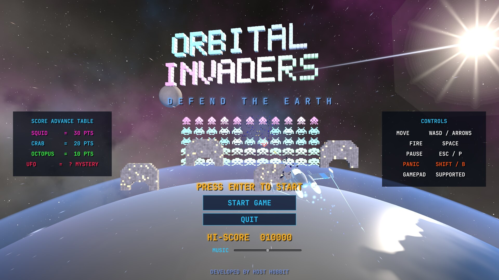
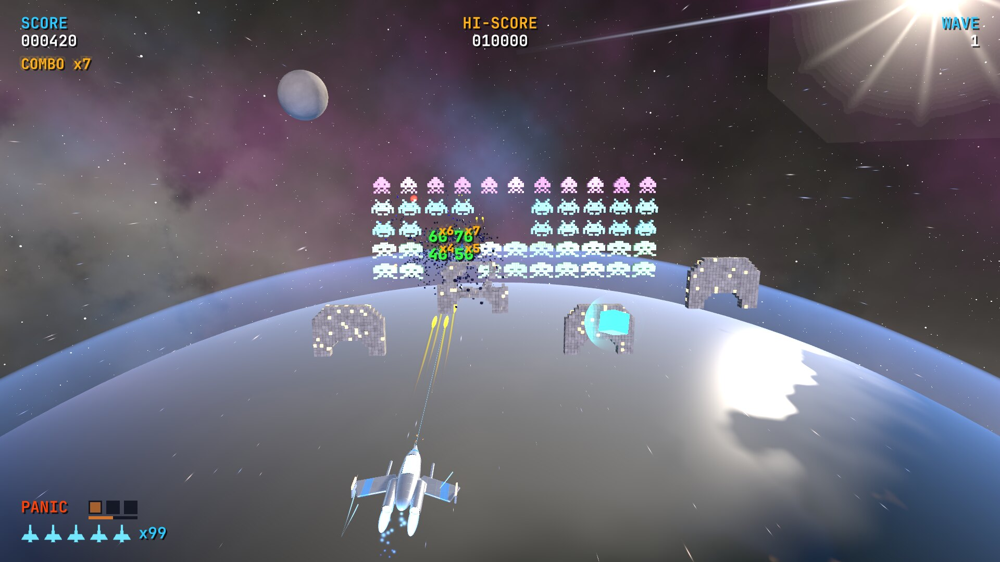
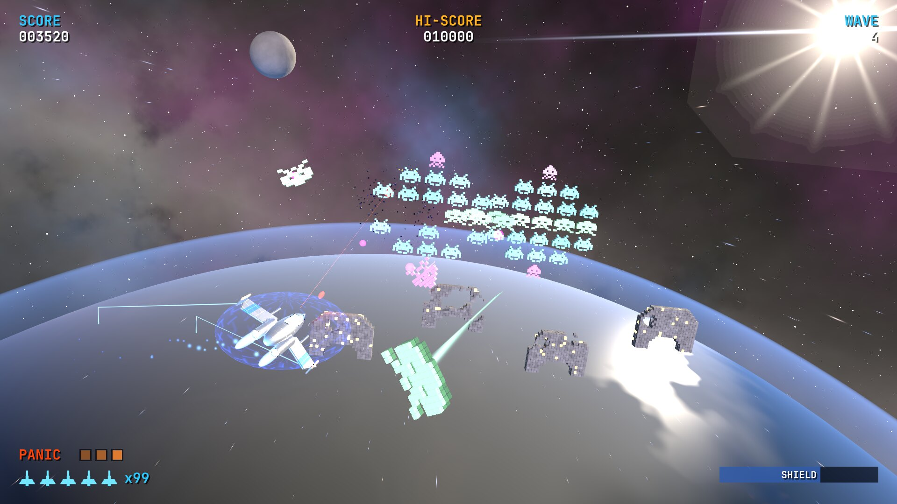
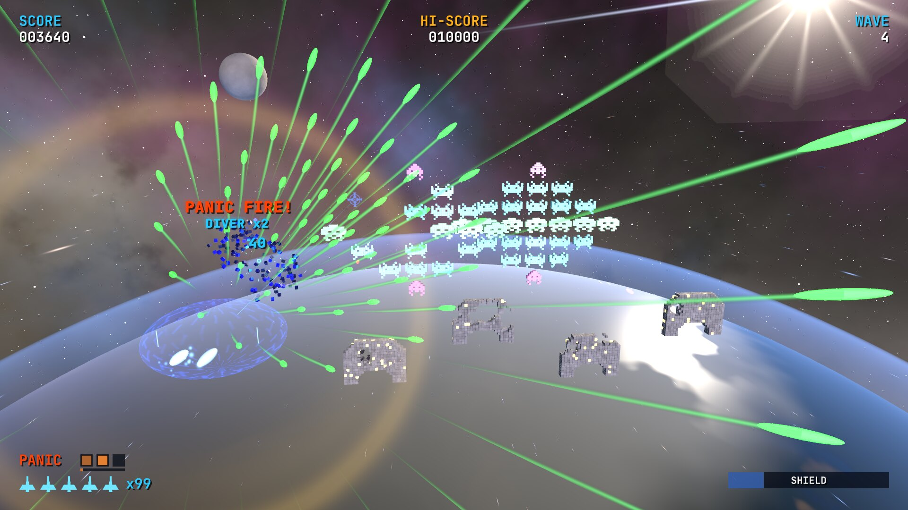
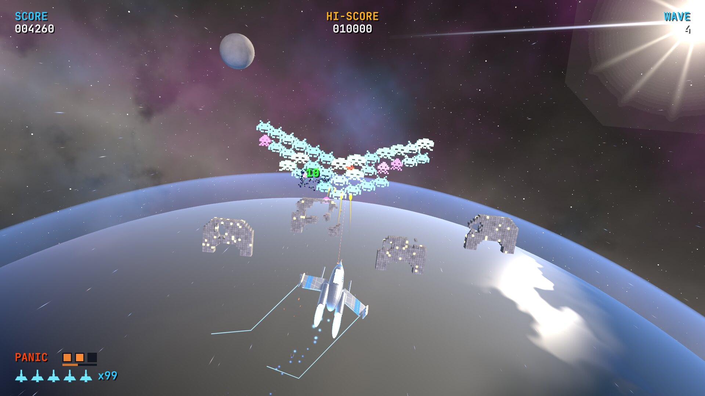
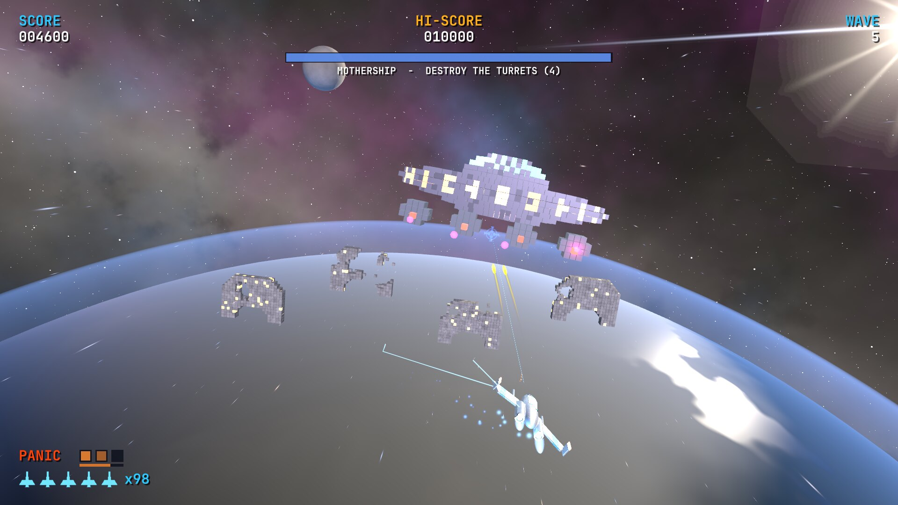
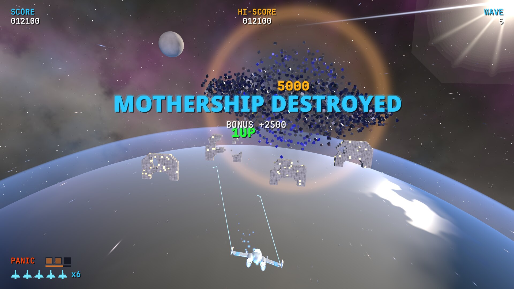
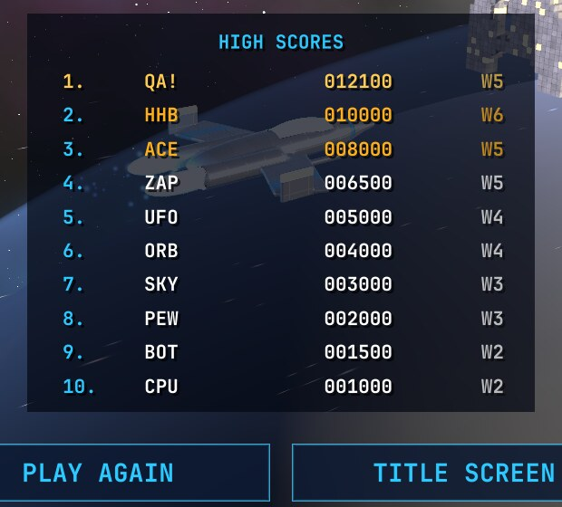

# Orbital Invaders

**Developed by [Host Hobbit](https://hosthobbit.com)**

Space Invaders, brought up to date and taken into 3D. Built in Unity 6 (URP). Your fighter guards the Earth from low orbit, and the invader wall marches *toward* you through space instead of down the screen. Invaders peel off and dive at you, regroup into new formations when you start winning, and every fifth wave a mothership arrives.

| | |
|---|---|
|  |  |
| **Divers** swoop in on 3D paths | **Panic fire** sprays bolts in every direction |
|  |  |
| Losing invaders **regroup** into new shapes | The **mothership** and its four turrets |
|  |  |
| Every hull voxel blows apart | Top-ten **high scores** with initials |

## Features

- **The classic, in 3D.** The voxel squids, crabs and octopuses march side to side to the familiar four-note beat. At each edge they step *toward* you, and they speed up as their numbers fall. Let them reach you and the Earth is lost.
- **Four opening formations** that cycle through the waves: the classic wall, a double wall, a hollow chevron and twin diamonds, layered in depth.
- **Divers.** From wave 2, front-line invaders break formation and swoop at your ship on curved 3D paths. They fire one aimed shot as they pass, then warp back into line. Shooting a diver is worth double points.
- **They regroup when you're winning.** Kill a third of a wave, or rack up eight kills in four seconds, and the survivors fly into a new shape: *Ring of Fire*, *Arrowhead*, *The Cube* or *Corkscrew*. They get angrier each time, firing and diving more.
- **The mothership.** On every fifth wave a giant voxel saucer arrives. Its core is armoured until you destroy its four turrets. Once below half health it starts firing spiral barrages.
- **Mystery UFO** flybys, worth a random bonus.
- **Destructible bunkers** that wear away voxel by voxel under fire from both sides.
- **Power-ups:** Spread Shot, Rapid Fire, Piercing Laser, Shield and Smart Bomb.
- **Panic fire.** An emergency burst of piercing bolts in every direction that also wipes out nearby enemy bullets. You start with one charge, earn another every 20 kills, and can hold up to three.
- **Combos** up to ×8 for quick kills, plus an extra life every 10,000 points.
- **A top-ten high score table** with arcade-style three-letter initials.
- **Everything is generated by code:** the voxel models, textures, materials, the scene, and all the music and sound effects, which are synthesised at startup.

## Controls

| Action | Keyboard / mouse | Gamepad |
|---|---|---|
| Move (left/right and up/down) | WASD or arrow keys | Left stick |
| Fire (hold for automatic) | Space, Enter, left Ctrl or left click | A |
| Panic fire | Shift, B or right click | B or Y |
| Pause | Esc or P | |
| Enter initials | Type letters · ↑↓ change · ←→ move · Enter saves | Stick up/down · A next · B back |

## Playing

**Linux:** run `./build.sh` once, then `./play.sh`.

`play.sh` checks free GPU memory first and refuses to start below 1.5 GB (set `MIN_FREE_MIB` to change this). On NVIDIA under Wayland, running out of video memory can take the whole desktop down with the game.

**Unity Editor:** open the folder with Unity **6000.6.3f1** and press Play.

## Building

`./build.sh` regenerates every asset and the scene, then builds the Linux player to `Build/Linux/`. It runs Unity with `-batchmode -nographics`, so building never touches the GPU. It takes about 30 seconds, and the log goes to `Logs/build.log`. If Unity isn't at `~/Unity/Hub/Editor/6000.6.3f1`, set `UNITY=/path/to/Editor/Unity`.

## Automated testing

`./qa.sh <dir> [width height]` plays a scripted run and saves screenshots to `<dir>`. The run covers the title screen, waves, power-ups, divers, panic fire, all four regroup formations, a death, the mothership fight and kill, and high score entry.

It runs entirely on the CPU, using a virtual X display (Xvfb) and Mesa's llvmpipe OpenGL, with the NVIDIA driver hidden from the game, so it never uses video memory or your desktop session. It expects Xvfb and Mesa's lavapipe Vulkan driver unpacked under `~/.local/opt/swrender` (override with `SWRENDER`). Test runs keep a separate high score file, so they never touch your real table. The screenshots in this README come from that renderer, so the game looks richer on a real GPU.

## Code

Everything lives in `Assets/Orbital/`:

- `Scripts/Game.cs`: waves, shots, collisions, scoring, panic fire, initials entry and the scripted test run
- `Scripts/Formation.cs`: the marching wall, layouts, divers and regrouping
- `Scripts/Invader.cs`, `Boss.cs`, `Ufo.cs`, `Bunker.cs`, `Player.cs`, `PowerUp.cs`: the actors
- `Scripts/HighScores.cs`: the top-ten table (JSON in Unity's persistent data folder)
- `Scripts/SoundBank.cs`: the synthesised sound effects and music
- `Scripts/CameraRig.cs`, `PostFx.cs`, `Fx.cs`, `SpaceScene.cs`: the camera, effects and backdrop
- `Editor/OrbitalBuilder.cs`: generates all assets, the scene and the build
- `Shaders/`: the URP shaders for the hulls, glow, Earth, atmosphere and sky

## Enjoying it?

If you like the game, say thanks or buy me a coffee ☕. A ⭐ on this repo goes a long way, or get in touch through **[hosthobbit.com](https://hosthobbit.com)**.

## Fonts

The UI uses Noto Sans Black (`Assets/Orbital/Resources/TitleFont.ttf`) and JetBrains Mono Nerd Font (`Assets/Orbital/Resources/HudFont.ttf`), both licensed under the SIL Open Font License 1.1.

---

© Host Hobbit Ltd
